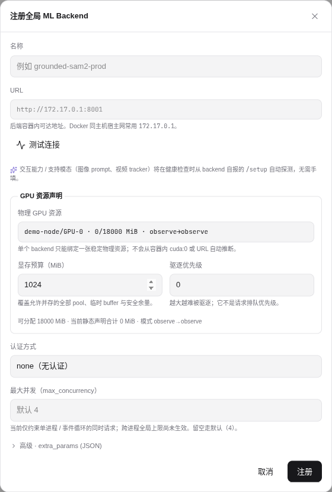

# 模型服务注册（全局注册表） {#ml-backend-注册-全局注册表}

模型服务是平台调用的推理服务。注册表是**全局**的：一个物理服务实例对应一行 `ml_backend_registry` 记录，同一 URL 只注册一次，所有项目共享该记录。项目侧从全局注册表里**勾选启用**，详见 [启用模型服务](../projects/ml-backends)。模型权重、服务实例和服务池的区别，以及 Token 的基本用途，见[模型服务接入、路由与认证](../../dev/concepts/ml-backend-routing-and-auth)。

## 入口

- 全局注册（新增 / 编辑 / 删除 / 健康检查，仅超管）：`/model-market` → **注册管理** tab
- 项目启用（勾选已注册模型服务 + 项目级覆盖，项目管理员 / 超级管理员）：项目设置 → **模型服务** tab

已有推理服务，选**直连**：让作者部署受认证的 HTTP 端点，在这里登记 URL 和手动 Token，检查模型能力，并在「服务池」确认同名池已启用，再由项目负责人启用该池。无须提供 OCI 镜像或安装 manifest；启动、更新和停止服务仍由其运营者负责。需要由平台核对固定镜像、资源和排空证明时，走[安装官方与自定义推理插件](/plugins/manage/inference-install)。两条路径都不会自动为项目启用。可用真实 CPU 图片逐步核对[直连注册与预测](/plugins/protocols/http-from-scratch#direct-registration)。

## 表单字段



| 字段         | 含义                         | 约束                                                                                                                       |
| ------------ | ---------------------------- | -------------------------------------------------------------------------------------------------------------------------- |
| 名称         | 显示名                       | 名称无全局唯一性约束，同名服务仍由实例 ID 和 URL 区分；`ml_backends` 表无 UNIQUE 索引                                      |
| URL          | 模型服务 HTTP 入口           | **全局唯一**（同一 URL 只能注册一次）；**不能填 loopback**（详见下）                                                       |
| 交互能力     | 是否支持工作台交互式推理     | 健康检查时从 `/setup` 自动探测，无需手填                                                                                   |
| 认证方式     | 系统托管、手动 Token 或 None | 新注册的地址匹配部署可信地址时默认选择对应的系统托管方式；None 不发送凭据                                                  |
| 手动 Token   | 调用该服务的访问凭据         | 与服务端配置一致；编辑留空保留原值，首次设置或从系统托管切回手动时必须填写                                                 |
| GPU 物理资源 | 稳定 `gpu_resource_id`       | 从运维显式配置的逐卡资源中选择；留空不等于已确认 CPU                                                                       |
| 显存预算     | `vram_budget_mb`             | 与 GPU 资源成对填写，正整数 MiB，不得超过该卡 `allocatable_mb`                                                             |
| 驱逐优先级   | `eviction_priority`          | 数值越大越难被驱逐，可为负数，不是请求队列优先级                                                                           |
| 最大并发     | `max_concurrency`            | 1 至 32；始终作为单进程 / 事件循环的本地背压；`ML_BACKEND_ROUTER_MODE=enforce` 时还作为 Redis route lease 的跨进程实例上限 |
| 额外参数     | JSON 扩展字段                | 不得与上述强类型字段冲突                                                                                                   |

表单不提供类型选择器、默认提示或默认阈值。服务能力由服务自身通过 `/setup` 声明；交互式标注、图像输入提示和视频追踪等能力在健康检查时读取，无需手填。`max_concurrency` 由表单单独填写后保存到 `extra_params` JSONB；其他扩展参数仍在高级 JSON 中编辑。

## URL 校验：拒绝 loopback

后端 Pydantic `field_validator` 会直接拒绝以下 host（`apps/api/app/schemas/ml_backend.py:8`）：

- `localhost`
- `127.0.0.1`（精确匹配，**不**拒绝整个 `127.x.x.x` 段）
- `0.0.0.0`
- `::1`

错误消息会指引你填正确的地址。背后原因：容器内 `localhost` 指向容器自身，不可能连到宿主机的模型服务。详见 [容器网络与 loopback](../../dev/troubleshooting/container-networking)。

**正确填法：**

| 场景                            | URL                                                                                          |
| ------------------------------- | -------------------------------------------------------------------------------------------- |
| 模型服务在同一个 docker-compose | `http://grounded-sam2-backend:8001`                                                          |
| 模型服务在宿主机 / 局域网       | `http://172.17.0.1:8001`（Linux 默认 bridge）/ `http://host.docker.internal:8001`（mac/win） |
| 模型服务在另一台机器            | LAN IP / 域名                                                                                |

宿主机服务必须实际监听目标私网接口，并限制访问来源。`yoao-plugin dev` 只监听 loopback，不能直接填入注册表；请让作者使用部署入口。开发机浏览器能访问、表单「测试连接」成功，都不能替代从执行进程到模型、再从模型到签名图片的双向可达性检查。

## 认证方式与凭据

编辑已有实例时，可直接切换认证方式或更换 Token，包括已经受 GPU 管理的实例，无需先退役。认证属于全局实例，保存后所有引用它的项目共用新凭据；请与服务端配置保持一致。平台会清除该实例原有的健康结果，执行健康检查通过后再使用。URL、GPU 资源、显存预算、驱逐优先级与运行参数的变更仍受 GPU 退役保护：先停止接收新工作，等待活动工作实际结束并卸载模型；停止接流或在途计数归零本身不能证明工作已经结束。

系统托管按部署配置的可信地址区分服务，不按插件名称或是否在本机运行判断。默认配置包含 YOLO、ONNXTools、RapidOCR；Grounded SAM 2 与 SAM 3 需由部署管理员显式加入。表单只允许选择已配置地址的托管方式。保存时平台生成或复用该服务的私有凭据，并在指定地址验证服务身份。超管也可在「设置 → 系统设置 → ML 服务认证与维护」初始化并同步已有的无认证或托管实例；手动 Token 不会被覆盖，未注册服务不会因此自动注册或在项目中启用。

旧部署首次接入需升级到支持共享凭据的固定镜像，并重新创建容器以应用只读挂载。之后初始化与同步凭据无需重建容器。凭据已保存只表示本地文件可用；普通 `/health` 不证明认证就绪。系统托管保存会额外验证 `/managed-auth`，失败时保留本地文件供重试，实例原认证不变。保存成功后执行实例健康检查更新状态。

若握手期间另一个操作修改了实例地址或认证，保存返回冲突，保留后一个操作已保存的配置；请刷新实例后再决定是否更新。握手不会经由环境代理或跟随重定向发送凭据。

服务端要求 Bearer 且不使用系统托管时，选择手动 Token，不以服务在本机还是远程判断。YOLO 的手动 `YOLO_MANAGED_MODELS_TOKEN` 优先；模型回流要求至少 32 个字符。编辑已有手动 Token 时留空保留原值；从系统托管切回手动 Token 必须重新填写。`none` 始终不发送凭据。

这里的 Token 是平台调用模型服务的凭据，与个人 API 密钥分别管理。使用系统托管时不填写 Token；使用共享凭据目录的服务若未设置手动 Token，则从自己的私有文件读取凭据。缺少有效凭据时拒绝受保护请求，不会自动关闭认证。再次初始化只复用并同步已有值，不会轮换凭据。

## 健康检查

<!-- TODO IMAGE_CHECKLIST: images/superadmin/ml-backend/health-state-badges.png — connected/error/disconnected 三状态徽章对比 [manual] -->

通过认证设置校验后，注册会自动调用 `GET <url>/health`。普通健康检查失败不阻断创建，但列表会显示错误状态，`state` 取值为 `disconnected`、`connected` 或 `error`。系统托管的认证握手失败会阻止保存，不能用公开健康端点成功代替认证验证。

**注册前连通性测试**：手动 Token 或 None 方式可通过表单「测试连接」调用 `POST /admin/ml-integrations/probe`，只探测 `/health`，不写数据库。系统托管在保存时验证受认证端点，表单会禁用普通「测试连接」。连接成功只证明健康端点可达。

探测和试启动保留管理员对内网与新服务地址的诊断能力，URL 须为有效 HTTP(S) base URL，不含内嵌凭据、查询参数或 fragment；认证 token 单独填写。网络失败只回报安全的错误类别。项目预热还要求模型服务已启用于该项目；共享的重新加载和卸载继续按超级管理员全局权限执行。服务声明支持预热不代表模型已经加载，预热结果和健康检查各自提供不同的状态证据。

运行观测按规范化地址识别已注册实例，并使用该实例当前的认证方式；显式选择 `None` 时不会回退读取本地托管凭据。同址出现多个候选实例时返回冲突，需要先处理重复记录，而不是任选一份凭据。

## 全局注册 CRUD（超管）

注册管理 tab 对全局注册表做增删改查，对应后端端点：

```http
POST   /admin/ml-integrations/registry                  # 新增全局模型服务实例
PUT    /admin/ml-integrations/registry/:registry_id     # 编辑
DELETE /admin/ml-integrations/registry/:registry_id     # 删除
POST   /admin/ml-integrations/registry/:registry_id/health   # 健康检查（探 /setup 派生能力）
GET    /admin/ml-integrations/all                        # 全局列表（新建项目向导复用）
```

每个全局模型服务实例注册后会自动得到一个单成员服务池（ADR-0050），池内含一个接流成员指向该实例。off／observe 模式沿用原有实例选择，enforce 模式在合格成员中分配请求；停止接流和执行安全检查始终生效。详见 [ADR-0050 服务池与请求路由](https://github.com/YOAO-Labs/YOAO/blob/dev/docs/adr/archive/0050-ml-backend-service-pools-and-request-routing.md)。

<span id="可安装推理插件" aria-hidden="true"></span>

## 可安装推理插件

容器模式的官方或第三方推理插件须由超级管理员在部署机运行 `yoao plugins` 完成安装、GPU 资格核验、资产测量批准与升级退役。完整命令行操作、环境变量与收据迁移指南已独立归档至：

- [安装官方与自定义推理插件](/plugins/manage/inference-install) — `deployment.json`、`prepare` / `qualify` / `install` / `approve-assets` / `restart` / `upgrade`
- [历史清单与本地收据迁移](/plugins/manage/legacy-migration) — `alembic plugin_capabilities_inventory` 与 `yoao plugins migrate-state`

<span id="历史清单与本地收据迁移" aria-hidden="true"></span>

## 服务池管理（超管）

<!-- TODO IMAGE_CHECKLIST: images/superadmin/model-market/registry-service-pools.png — 注册管理服务池主视图（结构化 tab + 展开成员 + 维护操作） [auto] -->

服务池是路由选择的逻辑边界，实例是可定位到物理 URL 的 registry 记录。一个池可含多个等价实例（同模型 / 同 schema，capability 指纹 exact match）。注册管理 tab 的「服务池」视图对池做增删改查 + drain / resume：

```http
GET    /admin/ml-integrations/service-pools                       # 列表（含成员）
POST   /admin/ml-integrations/service-pools                       # 新建池
GET    /admin/ml-integrations/service-pools/:pool_id              # 单池详情
PATCH  /admin/ml-integrations/service-pools/:pool_id              # 改名 / 启停
DELETE /admin/ml-integrations/service-pools/:pool_id              # 删除池
PUT    /admin/ml-integrations/service-pools/:pool_id/members/:registry_id   # 加入/改权重
DELETE /admin/ml-integrations/service-pools/:pool_id/members/:registry_id   # 移除成员
POST   /admin/ml-integrations/service-pools/:pool_id/members/:registry_id/drain    # active→draining
POST   /admin/ml-integrations/service-pools/:pool_id/members/:registry_id/resume   # draining→active
GET    /admin/ml-integrations/service-pools/:pool_id/members/:registry_id/capability-drift          # 预览能力差异
POST   /admin/ml-integrations/service-pools/:pool_id/members/:registry_id/capability-drift/accept   # 接受新基线
```

**drain / resume 语义**：

- **drain**：成员 `traffic_state` 从 `active` 切到 `draining`，停止接收新的执行；已在飞的请求继续完成。幂等。
- **resume**：`draining` 切回 `active`，恢复接流。幂等。`disabled` 成员不能直接 resume；这类状态需要先审核能力变更。
- drain / resume **只影响路由接流**，不触发模型权重卸载（那是 GPU 仲裁的 residency drain，独立）。
- off／observe 模式仍使用 legacy 实例，但该成员进入 `draining` 后也不再接受新的执行。已经开始并固定实例的跟踪作业可以完成既有工作。

**加入成员**：被加入的实例必须与池内现有成员 capability 指纹 exact match（同 `models[]` 模型目录、请求 schema、variant 组合和 tracker 等稳定能力，排除 URL/GPU/VRAM/residency 等运行态字段）。不匹配返回 `HTTP 409` 并附结构化 diff。对已在池内的成员再次 PUT 会更新权重，不会重置已有的 traffic state。同一实例不能同时属于两个服务池。

**审核能力变更**：健康刷新发现 `/setup` 的路由合同与服务池基线不一致时，平台会自动把成员设为 `disabled`；若它是 legacy 实例，还会关闭服务池。超管可在「服务池」展开成员或「实例」操作菜单中选择「审核能力变更」，查看旧/新指纹与 canonical 字段差异。确认时平台会重新执行健康与 `/setup` 探测，并校验候选指纹没有在审核期间再次变化；池内若仍有能力不一致的 active / draining 成员则拒绝。验证通过后，新基线、成员 `active` 状态、路由代际和可选的服务池启用在同一事务中提交。若实例已经回滚到原基线，则只恢复成员与服务池，不改写基线。该操作只接受明确审核过的合同，不会自动放行 capability superset。

**卸载 / 移除成员 / 删除**：纳管实例必须先进入 `draining`。新鲜的零在途观测只允许提交卸载请求，服务端还会核验后台执行和控制状态；超时、通信中断、缓存清空或租约过期均不能证明任务已经结束。管理结果未确认时保持阻塞。升级后需先由运维完成[后端控制绑定](../../api/guides/inference-runtime#持久路由执行权)，再管理实例；无法确认时返回冲突或服务不可用。删除服务池前必须逐一安全移除所有成员，空池才可删除。

GPU 自动驱逐在卸载回包丢失后仍会复查健康状态。只有新鲜且匹配的实际卸载证据才能回收预算；检查失败或状态无法确认时，继续保留未决状态与预算。

移除成员或删除实例时，若安全检查后成员被恢复接流、移到其他池或路由代次改变，返回409；请重新读取状态、drain 并重试。删除清理项目主绑定遇到正在保存的项目配置时，也返回409并回滚整个删除。项目配置等待服务池期间所选实例被删除或移走，同样拒绝本次保存；刷新清单后重新选择。

加入、移除、drain 和 resume 成功后返回已提交的最新服务池状态。若连接中断、没有收到结果，先读取服务池详情核对成员和路由代际，再决定下一步；再次移除已不存在的成员会返回404。

## 项目启用

注册仅是创建可选项，不代表当前已连接，也不会自动为项目启用。目录可来自缓存。超管先检查实例健康与能力，并在「服务池」确认全局池已启用；使用强制路由的直连实例还需由运维完成[路由连续性绑定](/api/guides/inference-runtime#route-continuity)。然后由项目负责人操作：

1. 项目设置 → **模型服务** → 点「管理模型服务」在全局模型服务清单里**勾选启用**该服务（推理参数运行时按服务自报的 `/setup.params` 调，不在此预设）
2. 同一页在 **项目主模型服务** 下拉里选一个**已启用**的模型服务（设置后即启用 AI 预标注）
3. 选择后即时生效，无需额外保存。

未设项目主模型服务直接跑预标会报错，并在前端给出配置引导。详见 [启用模型服务](../projects/ml-backends)。

## 引用全局注册项（不复制）

新建项目向导提供下拉框选择已注册的全局模型服务；选中即为新项目**启用**该全局注册项（**引用同一全局 ID，不再复制一份**）。这样所有项目共享同一服务实例记录，能力快照与健康状态一处维护、处处一致。

后端：`GET /admin/ml-integrations/all` 返回全局注册表列表。

## 删除

物理删除全局模型服务实例是**超管职责**（`DELETE /admin/ml-integrations/registry/:registry_id`）。删除前若有正在运行的预测任务、未完成 GPU 退役，或者管理安全检查尚未确认停止接流和后台任务结束，都会返回冲突或服务不可用错误并保留数据。条件全部满足后，删除会解除该实例的服务池成员关系；若它是原有的兼容实例，所属池会停用并清除项目主绑定。历史预测仍按外键策略保留可追溯性。

从未纳管 GPU 的普通模型服务实例可在上述检查通过后正常删除；具有 GPU 历史的实例仍须完成相应退役与回收流程。

项目管理员不能物理删除全局模型服务实例，只能在项目设置里**取消勾选启用**让它对本项目停用（不影响其它项目）。

## 审计

以下事件写入 `audit_logs`：

- `ml_registry.created` / `ml_registry.updated` / `ml_registry.deleted`（全局注册 CRUD）
- `ml_plugin_installation.prepared` / `launch_recorded` / `qualification_approved` / `activated` / `disabled` / `quiesced` / `retired` / `assets_updated`（插件身份、生命周期和资产批准动作；不记录实例 Token）
- `ml_registry.managed_auth_initialized`（默认凭据初始化与同步）
- `ml_backend.maintenance_requested`（系统设置提交指定服务的镜像与容器维护）
- `ml_service_pool.created` / `updated` / `deleted`（服务池 CRUD）
- `ml_service_pool.member_upserted` / `member_removed` / `member_drained` / `member_resumed`（成员与接流状态）
- `ml_service_pool.capability_drift_accepted`（审核并接受新的池能力基线）
- `ml_backend.created` / `updated` / `deleted` / `enablement`（项目兼容端点）
- `ml_backend.reloaded` / `ml_backend.unloaded` / `ml_backend.warmup`（生命周期动作）
- `ml_backend.smoke_tested`（模型市场试启动）

详见 [审计日志](./audit-logs)。

## 相关操作

- **观测（observe）**：`GET /admin/ml-integrations/observe` 直连 env 配的模型服务容器，不需要项目注册即可看健康 / 变体目录。
- **试启动（smoke-test）**：`POST /admin/ml-integrations/observe/smoke-test`，只有新协议 residency 能严格证明所有 pool / builder / borrower 已空时才预热指定变体并自动还原；旧协议会同时保守检查图像池、视频池与活跃会话。
- **GPU 资源诊断**：超管可查看逐卡容量、静态预算、desired → effective mode 及配置 blocker。`observe` 仅记录影子决策，不会拒绝、排队或驱逐请求。
- **`max_concurrency`**：写入 `extra_params.max_concurrency`；本地 semaphore 始终生效，`ML_BACKEND_ROUTER_MODE=enforce` 时再由持久路由 owner 把 API 与多个 Celery worker 收口到同一实例上限。GPU 仲裁的逐资源 effective mode 管显存准入与驱逐，是另一条独立门禁。

训练完成后的候选注册、加载试用和人工发布见[模型回流与默认预标](../online-learning/models)。全局服务注册不会自动把权重加入项目模型。

## 相关

- [ADR 0015 — ML Backend URL 验证](https://github.com/YOAO-Labs/YOAO/blob/dev/docs/adr/archive/0015-ml-backend-url-validation.md)
- [模型市场](./model-market)
- [Inference Protocol v2（ML Backend 协议）](/plugins/protocols/inference-v2)
- [官方推理插件目录](/plugins/official/)
- [模型服务接入、路由与认证](../../dev/concepts/ml-backend-routing-and-auth)
- [本机 ML 服务维护](../../ops/deploy/ml-backend-maintenance)
